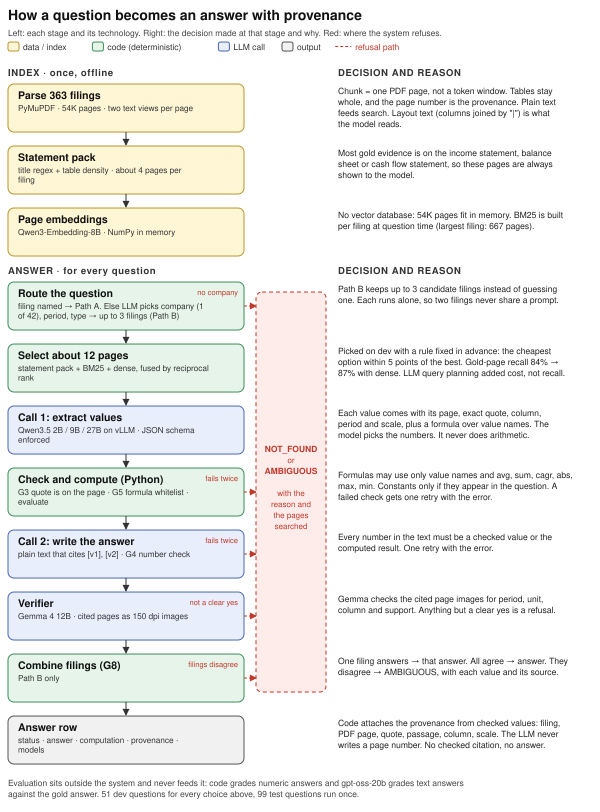
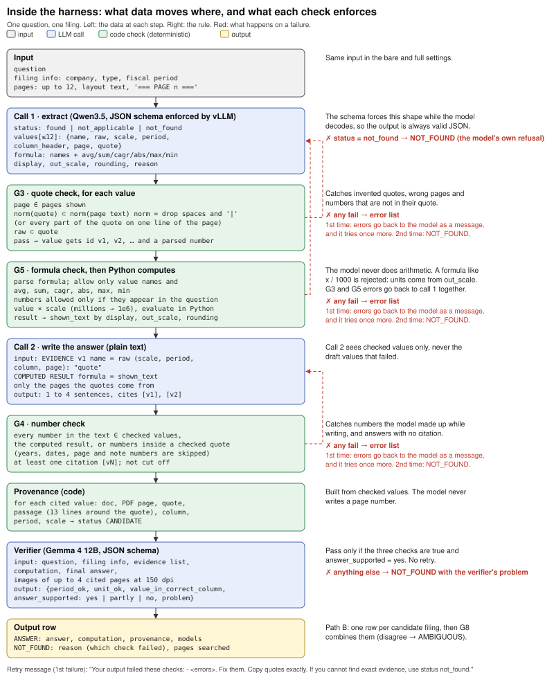

# FinanceBench QA with provenance: a comparative study

An experiment on the 150 FinanceBench questions. It compares Qwen3.5 models at three sizes (2B, 9B, 27B), with and without a checking pipeline (the "harness"). For every question, each configuration gives an answer with the PDF page, quote and passage behind it, or it refuses and says why. The goal is to learn which model and which setup to use for a later project. This repository does not build a product.

- **Demo: https://finqa-demo.vercel.app.** It replays recorded runs step by step, lets you browse every configuration's 150 answers with the cited pages, and shows the system diagrams. The same page is in [`viewer/index.html`](viewer/index.html) and opens locally without a server.
- **Write-up:** [`docs/report.pdf`](docs/report.pdf), 2 pages plus the diagram on page 3.
- **All answers with provenance:** [`results/answers.md`](results/answers.md) (9B), [`results/answers-all-27b-full.md`](results/answers-all-27b-full.md), [`results/answers-all-2b-full.md`](results/answers-all-2b-full.md), [`results/answers-pathb-27b-full.md`](results/answers-pathb-27b-full.md).

## Results in one table

Every configuration is reported as three counts out of 150: correct, wrong, refused (decision A24 in [`docs/assumptions.md`](docs/assumptions.md)). No configuration is "the official one". The table is the comparison.

| Model | Setting | Correct | Wrong | Refused |
|---|---|---|---|---|
| Qwen3.5-2B | bare | 77 | 72 | 1 |
| Qwen3.5-2B | full harness | 12 | 2 | 136 |
| Qwen3.5-9B | bare | 93 | 57 | 0 |
| Qwen3.5-9B | full harness | 72 | 16 | 62 |
| Qwen3.5-27B (FP8) | bare | 101 | 48 | 1 |
| Qwen3.5-27B (FP8) | full harness | 80 | 20 | 50 |
| Qwen3.5-27B (FP8) | full harness, no filing named (Path B) | 76 | 16 | 58 |
| GPT-4 Turbo, FinanceBench paper, single store (human labels) | | 75 | 17 | 58 |
| GPT-4 Turbo, FinanceBench paper, shared store, no filing named (human labels) | | 29 | 20 | 101 |

How to read it:

- **The harness trades correct answers for fewer wrong ones.** For 9B it removes 41 wrong answers and gives up 21 correct ones, which become refusals.
- **A bigger model gets more right in every setting.** With the harness, 27B gets 8 more correct answers than 9B and 4 more wrong ones. On the 99 held-out test questions alone, 27B is ahead on both counts: 54 correct and 10 wrong, against 46 and 11 for 9B.
- **2B makes almost no wrong answers with the harness, because it answers almost nothing** (14 of 150).
- **Without the filing named, 27B still gets 76 right.** GPT-4 Turbo got 29 in the paper's matching setup. Both have a similar number of wrong answers. The paper used human graders and we used a model judge, so this comparison is approximate.
- **Questions with no answer in the filing:** of 290, the harness gave 0 false answers with 2B and 9B and 1 with 27B. The same models without the harness gave 53, 20 and 22.

## Bare model against full harness

Both settings use the same model and the same retrieved pages. Only the work around the model differs.

- **Bare:** question + 12 pages → model → answer. Nothing checks the answer.
- **Full harness:** the model must list each value with its page and exact quote. Code checks every quote, Python does the arithmetic, code checks every number in the answer, and a second model (Gemma 4 12B) checks the cited page images. If any check fails, the system refuses and gives the reason.

The difference between the two rows of a model shows what the checks add, apart from how good the model is.

## Who refuses: the model or the harness

| Model, full harness | Refused | The model itself said "not found" | Harness code (a check failed twice) | Verifier (Gemma) |
|---|---|---|---|---|
| 2B | 136 | 70 | 62 | 4 |
| 9B | 62 | 18 | 35 | 9 |
| 27B | 50 | 14 | 30 | 5 |

Most refusals come from the harness. A smaller model fails the format checks more often, so it refuses more. That is also why 9B has fewer wrong answers than 27B: some questions that 27B answered wrongly, 9B never got past the checks.

## How it works



Each stage is on the left with its technology, and the decision behind it is on the right. Red marks where the system refuses. Generated by [`docs/diagrams/system_flow.py`](docs/diagrams/system_flow.py).

1. **Index (once).** PyMuPDF reads every page twice: plain text for search, layout text (columns joined with `|`) for the model to read. One chunk is one PDF page. Pages whose title is a primary financial statement form a "statement pack" for each filing.
2. **Retrieve.** For the filing: the statement pack, the top BM25 pages and the top pages by embedding similarity (Qwen3-Embedding-8B), at most 12 pages.
3. **Call 1: extract.** The model returns JSON (schema enforced by vLLM): each value with page, exact quote, column, period and scale, plus a formula over value names.
4. **Code checks and Python.** G3: the quote is on the page and the value is in the quote. G5: the formula uses only value names and avg, sum, cagr, abs, max, min. Python computes.
5. **Call 2: answer.** Plain text citing `[v1]`. G4: every number must be a checked value or the computed result.
6. **Verifier.** Gemma 4 12B checks period, unit, column and support on images of the cited pages.
7. **Output.** ANSWER with provenance attached by code, or NOT_FOUND / AMBIGUOUS with the reason.

A failed check gets one retry with the error list, then NOT_FOUND. With no filing named (Path B), a router picks up to 3 candidate filings, each runs separately, and disagreement gives AMBIGUOUS.

### Inside the harness



The data at each step, the rule each check enforces, and where a failure goes. Generated by [`docs/diagrams/harness_detail.py`](docs/diagrams/harness_detail.py).

Every design decision, with its evidence and what happens if it is wrong, is in [`docs/assumptions.md`](docs/assumptions.md) (A1 to A24). The run log is in [`docs/IMPLEMENTATION.md`](docs/IMPLEMENTATION.md).

## Evaluation method

- **Split.** 51 dev questions for all tuning, 99 test questions run once with the frozen harness ([`eval/split.json`](eval/split.json), stratified by question type, seed 0).
- **Labels.** Correct, wrong or refused, reported as three counts.
- **Grading.** If the gold answer is a number, code checks it at the gold answer's precision (trailing zeros carry no precision: "$8.70" means 8.7), with unit conversion. Otherwise gpt-oss-20b compares the answer with the gold answer and its justification. The pipeline never sees gold data, and a test checks this.
- **Judge calibration.** On the paper's 2,400 human-labeled answers, gpt-oss-20b agrees with the humans 77% of the time. It calls a wrong answer correct 5.9% of the time and a correct answer wrong 12.8% of the time. gpt-oss-120b, for reference: 80%, 5.9%, 11.5%.
- **Unanswerable set.** 290 questions: each question paired with another company's filing (150), or with its year shifted outside the filing (140). The correct output is always a refusal. Every answer on this set, bare or full, goes through the same refusal classifier, so an answer that only says "this filing is about another company" counts as a refusal.

## Detailed results

All numbers come from `python -m finqa.evals.tables` ([`results/tables.md`](results/tables.md), [`results/summary.json`](results/summary.json)). Nothing is typed by hand.

### Every setting (150 questions, filing named)

"Oracle" gives the model the gold pages instead of retrieved ones. It is a control that measures what retrieval costs. "Glossary" adds financial definitions to the prompt.

| Model | Setting | Correct | Wrong | Refused | Test only (99): correct / wrong / refused | Cited page is a gold page |
|---|---|---|---|---|---|---|
| 2B | bare | 77 | 72 | 1 | 54 / 44 / 1 | n/a |
| 2B | full | 12 | 2 | 136 | 7 / 1 / 91 | 11 of 14 |
| 2B | full + glossary | 12 | 0 | 138 | 8 / 0 / 91 | 10 of 12 |
| 2B | oracle pages | 15 | 4 | 131 | 9 / 3 / 87 | 19 of 19 |
| 9B | bare | 93 | 57 | 0 | 63 / 36 / 0 | n/a |
| 9B | full | 72 | 16 | 62 | 46 / 11 / 42 | 74 of 88 |
| 9B | full + glossary | 62 | 16 | 72 | 40 / 12 / 47 | 67 of 78 |
| 9B | oracle pages | 73 | 17 | 60 | 50 / 11 / 38 | 90 of 90 |
| 27B (FP8) | bare | 101 | 48 | 1 | 67 / 31 / 1 | n/a |
| 27B (FP8) | full | 80 | 20 | 50 | 54 / 10 / 35 | 86 of 101 |
| 27B (FP8) | oracle pages | 92 | 13 | 45 | 59 / 7 / 33 | 107 of 107 |
| 27B (FP8) | Path B, no filing named | 76 | 16 | 58 | 50 / 7 / 42 | 69 of 92 |

The glossary was not run for 27B, because it lowered coverage for 2B and 9B without reducing wrong answers.

### Questions with no answer in the filing (290 per model)

| Model | Bare: false answers | Full harness: false answers |
|---|---|---|
| 2B | 53 | 0 |
| 9B | 20 | 0 |
| 27B (FP8) | 22 | 1 |

### Size ladder

| | 2B | 9B | 27B (FP8) |
|---|---|---|---|
| Pass all code checks (reach the verifier) | 18 | 97 | 106 |
| Gain from gold pages, full harness (correct) | +3 | +1 | +12 |
| LLM seconds per question, full harness | 21 | 59 | 190 |

- A bigger model passes the checks more often, so it answers more.
- Gold pages help 27B a lot (+12 correct) and 9B hardly at all (+1). 9B loses its answers at reading and checking, so better pages do not help it. 27B can use better pages.

### Verifier (Gemma 4 12B) against the judge

Answers that passed every code check, before the verifier. "Let through" = the verifier accepted a wrong answer.

| Run | Checked | Accepted, correct | Accepted, wrong (let through) | Rejected, correct (lost) | Rejected, wrong (caught) |
|---|---|---|---|---|---|
| 2B full | 18 | 12 | 2 | 1 | 3 |
| 9B full | 97 | 70 | 18 | 2 | 7 |
| 27B full | 106 | 82 | 19 | 1 | 4 |
| 27B Path B (per candidate filing) | 165 | 127 | 27 | 1 | 10 |

The verifier rarely rejects a correct answer, but it lets most wrong answers through: it caught 7 of 25 for 9B and 4 of 23 for 27B. It is smaller than the 27B model it checks.

### Retrieval (dev, 51 questions, 12-page budget)

| Option | Gold page found |
|---|---|
| Statement pack + BM25 | 84% |
| **+ dense embeddings (used)** | **87%** |
| + LLM query planning | 87% |
| All of the above | 90% |

Rule fixed before the results: take the cheapest option within 5 points of the best.

### FinanceBench paper baselines (human labels, same 150 questions)

| Paper configuration | Correct | Wrong | Refused |
|---|---|---|---|
| GPT-4 Turbo, gold pages | 128 | 22 | 0 |
| GPT-4 Turbo, single store | 75 | 17 | 58 |
| GPT-4 Turbo, shared store | 29 | 20 | 101 |
| GPT-4, single store | 63 | 16 | 71 |
| Llama 2, single store | 62 | 81 | 7 |

## What worked

- **Checks between the model and the user.** For every size, the harness cut wrong answers sharply, and false answers on unanswerable questions fell to 0 or 1.
- **Code does the arithmetic and attaches the provenance.** Every answer cites a quote that exists on its page. When the filing is named, every answer cites that filing.
- **The statement pack.** Most evidence is on the three primary statements. Always showing those pages gave 84% recall before any learned retrieval.
- **Rules written before the results, and a held-out test set.** Test-only numbers track the full-set numbers, so tuning on dev did not overfit.
- **Routing without a named filing.** With 27B, Path B lost only 4 correct answers against Path A.

## What did not work

- **The verifier.** It catches about a quarter of the wrong answers that pass the code checks.
- **Definitions.** Most remaining wrong answers use a real, correctly cited number for a different definition of the metric: working capital from total instead of operating items, a different quick ratio, capex/revenue instead of assets/revenue. No check catches this, and a glossary in the prompt did not help.
- **Small models and strict checks.** 2B refuses 91% of questions. Its few answers are right, but it is not usable.
- **9B loses answers to format errors.** It fails code checks twice on 35 questions, for example by putting `/1000` in a formula or copying a quote inexactly.

## What would change the choice of model

- **If a wrong answer is far worse than a refusal:** 9B or 27B with the harness, plus a stronger verifier. 9B has slightly fewer wrong answers on the full set. 27B has more correct answers and is ahead on the held-out test set.
- **If coverage matters more:** 27B, which gets the most correct answers in every setting.
- **If cost matters:** 9B, which is about 3 times faster per question than 27B.
- **What to fix first, for any model:** a stronger verifier that also checks the formula against the question, and a way to show which definition of a metric the answer used.

## Limitations and compute

The work ran on Georgia Tech PACE ICE with a student allocation. 80 GB GPUs waited in the queue for more than a day, so:

- **27B ran in FP8** (`Qwen/Qwen3.5-27B-FP8`, 31 GB), on one 47 GB Blackwell partition. bf16 (52 GB) did not fit, and the partitions cannot be joined. FP8 is usually very close to bf16, but not identical.
- **A smaller verifier and judge:** Gemma 4 12B instead of a 27B verifier, gpt-oss-20b instead of gpt-oss-120b. The judge's calibration is above.
- **One run per configuration,** temperature 0. No variance across seeds.
- **Dev round 2 fixes were tested on 2B and 9B only,** because 27B could not get a GPU at that time.

With more compute: 27B in bf16 and larger models, a larger verifier with reasoning, the 120b judge, Path B for every size, and several seeds. Each model is one setting in the job script, so the harness does not change.

## Reproduce

```bash
scripts/fetch_data.sh                    # FinanceBench clone into data/
python -m finqa.cli embed                # page vectors (GPU)
./pace/submit.sh final                   # pass 1 for each run, on ICE (see pace/)
# verifier and judge: pace/job.sbatch with MODEL=google/gemma-4-12B-it / openai/gpt-oss-20b
python -m finqa.evals.judge regrade      # re-apply the code grading rule to existing judge files
python -m finqa.evals.publish --main all-9b-full --runs ...
python -m finqa.evals.tables > results/tables.md
python -m finqa.evals.viewer             # rebuild the demo data
pytest -q
```

Code layout: `finqa/` (pipeline: parse, retrieve, answer, checks, formula, verify), `finqa/evals/` (judge, metrics, tables, viewer, the only code that reads gold data), `pace/` (Slurm and vLLM scripts), `runs/` (every model output, JSONL).
