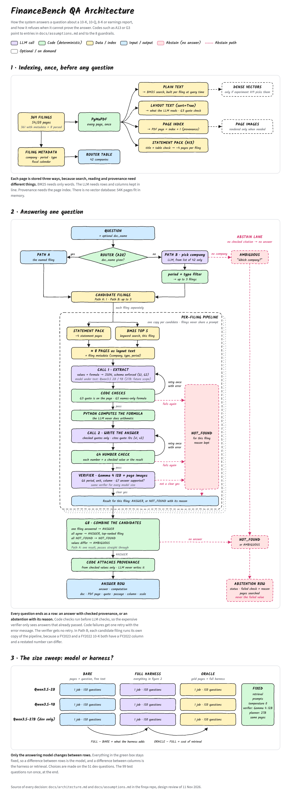

# FinanceBench QA with provenance

A question answering system for the 150 FinanceBench questions. For each question it returns an answer, the PDF page it came from, and the quote and passage that support it. If it cannot find and check that evidence, it says so and gives no answer.

The short write-up is [`docs/report.md`](docs/report.md). This README holds the full results. Every answer with its provenance is in [`results/answers.md`](results/answers.md).

## Main result

Official configuration: **Qwen3.5-9B with the full harness**, Path A (the filing is given). Verifier: Gemma 4 12B. Judge: gpt-oss-20b.

| | Correct | Wrong | Refused | Wrong-answer rate |
|---|---|---|---|---|
| Qwen3.5-9B, one prompt, same pages ("bare") | 91 | 59 | 0 | 39% |
| **Qwen3.5-9B, full harness** | **71** | **17** | **62** | **11%** |
| GPT-4 Turbo, FinanceBench paper, single vector store | 75 | 17 | 58 | 11% |

The harness cut the 9B model's wrong answers from 59 to 17, and coverage fell from 100% to 59%. With this trade, a local 9B model ends up close to the paper's GPT-4 Turbo single-store result. The two rows were graded differently (our judge model against the paper's human labels), so treat this as a rough comparison.

On 290 questions where the filing holds no answer (wrong filing, or the year shifted), the full harness answered 1 time. The bare model answered 20 times.

## How it works



1. **Index (once).** PyMuPDF reads every page twice: plain text for search, layout text (columns joined with `|`) for the model to read. Pages whose title is a primary financial statement form a "statement pack" for each filing.
2. **Retrieve.** For the question's filing: the statement pack, plus the top BM25 pages, plus the top pages by dense similarity (Qwen3-Embedding-8B). At most 12 pages.
3. **Call 1: extract.** The model returns JSON (schema enforced by vLLM): each value it needs, with the page, the exact quote, the column, the period and the scale, plus a formula over the value names.
4. **Code checks.**
   - G3: the quote is on that page, and the value is in the quote.
   - G5: the formula uses only value names and a few functions (avg, sum, cagr, abs, max, min). Python does the arithmetic. The model never does.
5. **Call 2: answer.** Plain text that cites values as `[v1]`.
   - G4: every number in the answer must be a checked value or the computed result.
   - A failed check gets one retry with the error message, then NOT_FOUND.
6. **Verifier.** A model from a different family (Gemma 4 12B) gets the question, the evidence, the answer and images of the cited pages. It must confirm the period, the unit, the column and the support. Anything other than a clear yes gives NOT_FOUND.
7. **Output.** ANSWER, NOT_FOUND or AMBIGUOUS. The provenance (filing, PDF page, quote, passage, column, scale) is attached by code from the checked values. The model never writes it. Each row also names the answering model and the verifier.

Path B (no filing given) is built: a router picks up to 3 candidate filings, each runs separately, and G8 combines them (if they disagree, the result is AMBIGUOUS). It was not evaluated, because its planned run used the 27B model (see Limitations).

Every design decision, with its evidence and what happens if it is wrong, is in [`docs/assumptions.md`](docs/assumptions.md) (A1 to A23). The design is in [`docs/architecture.md`](docs/architecture.md), and the run log is in [`docs/IMPLEMENTATION.md`](docs/IMPLEMENTATION.md).

## Evaluation method

- **Split.** 51 dev questions for all tuning and 99 test questions that were run once with the frozen harness. The split is stratified by question type with seed 0 ([`eval/split.json`](eval/split.json)).
- **Labels.** Correct, wrong or refused. The headline metric is the **wrong-answer rate** (wrong / 150), because a wrong answer costs more than no answer. We also report coverage (answered / 150) and selective accuracy (correct / answered).
- **Judge.** If the gold answer is a number, code checks it at the gold precision, with unit conversion. Otherwise gpt-oss-20b compares the answer with the gold answer and its justification. The pipeline never sees gold data. A test checks this.
- **Judge calibration.** Before we trusted the judge, it graded the paper's 2,400 human-labeled answers.
- **Unanswerable set.** 290 questions made by pairing each question with the wrong filing (150) or by shifting its year (140). The correct output is always NOT_FOUND.

## Results

All numbers come from `python -m finqa.evals.tables` ([`results/tables.md`](results/tables.md), [`results/summary.json`](results/summary.json)). Nothing below is typed by hand.

### Model size × harness (150 questions)

"Bare" = the same retrieved pages and one prompt, without checks. "Oracle" = the gold pages instead of retrieval. "Gloss" = a glossary of financial definitions added to the prompt.

| Model | Setting | Correct | Wrong | Refused | Wrong-answer rate [95% CI] | Coverage | Selective accuracy | Cited page is a gold page | Test only (99): wrong / correct |
|---|---|---|---|---|---|---|---|---|---|
| Qwen3.5-9B | bare | 91 | 59 | 0 | 39% [31 to 47] | 100% | 61% | n/a | 38% / 62% |
| Qwen3.5-9B | **full** | 71 | 17 | 62 | **11% [7 to 17]** | 59% | 81% | 84% | 12% / 45% |
| Qwen3.5-9B | full + glossary | 61 | 17 | 72 | 11% [7 to 17] | 52% | 78% | 86% | 13% / 39% |
| Qwen3.5-9B | oracle pages | 71 | 19 | 60 | 13% [7 to 19] | 60% | 79% | 100% | 13% / 48% |
| Qwen3.5-2B | bare | 73 | 76 | 1 | 51% [43 to 59] | 99% | 49% | n/a | 48% / 51% |
| Qwen3.5-2B | full | 12 | 2 | 136 | 1% [0 to 3] | 9% | 86% | 79% | 1% / 7% |
| Qwen3.5-2B | full + glossary | 12 | 0 | 138 | 0% [0 to 0] | 8% | 100% | 83% | 0% / 8% |
| Qwen3.5-2B | oracle pages | 14 | 5 | 131 | 3% [1 to 7] | 13% | 74% | 100% | 4% / 8% |

### Questions with no answer in the filing (290 per model)

| Model | Setting | False answers | Wrong filing | Shifted year |
|---|---|---|---|---|
| Qwen3.5-9B | bare | 20/290 (7%) | 5% | 9% |
| Qwen3.5-9B | full | 1/290 (0.3%) | 0% | 1% |
| Qwen3.5-9B | full + glossary | 2/290 (1%) | 1% | 1% |
| Qwen3.5-2B | bare | 53/290 (18%) | 17% | 20% |
| Qwen3.5-2B | full | 0/290 (0%) | 0% | 0% |
| Qwen3.5-2B | full + glossary | 2/290 (1%) | 1% | 0% |

### Where the 9B answers are lost (full harness, 150 questions)

| Stage outcome | Questions |
|---|---|
| Answered (all checks passed) | 88 |
| Extractor: evidence not in the retrieved pages | 18 |
| Number check (G4) failed twice | 12 |
| Formula check (G5) failed twice | 12 |
| Quote check (G3) failed twice | 11 |
| Verifier rejected | 9 |

### Verifier (Gemma 4 12B) against the judge

These are the answers that passed all code checks, before the verifier. "Leak" = the verifier accepted a wrong answer.

| Run | Checked | Accepted correct | Accepted wrong (leak) | Rejected correct (lost) | Rejected wrong (caught) |
|---|---|---|---|---|---|
| 9B full | 97 | 70 | 18 | 1 | 8 |
| 9B full + glossary | 85 | 61 | 17 | 1 | 6 |
| 9B oracle | 96 | 72 | 18 | 2 | 4 |
| 2B full | 18 | 12 | 2 | 1 | 3 |
| 2B full + glossary | 14 | 12 | 0 | 1 | 1 |
| 2B oracle | 24 | 14 | 5 | 1 | 4 |

On the 9B full run, the verifier caught 8 of 26 wrong answers and lost 1 correct one. It is cheap and rarely loses a correct answer, but it misses most wrong ones.

### Retrieval (dev, 51 questions, 12-page budget)

| Arm | Gold page recall |
|---|---|
| R0 statement pack + BM25 | 84% |
| **R1 + dense embeddings (used)** | **87%** |
| R2 + LLM query planning | 87% |
| R3 all of the above | 90% |

Rule fixed before the results: take the cheapest arm within 5 points of the best. R3 needs an extra LLM call per question, so R1 won.

### Judge calibration (paper's 2,400 human-labeled answers)

| Judge | Agreement | Says correct when humans say wrong | Says wrong when humans say correct |
|---|---|---|---|
| **gpt-oss-20b (used)** | 76% | 5.3% | 15% |
| gpt-oss-120b (reference) | 79% | 5.3% | 15% |

The 20b judge errs on the strict side. Most of the disagreement comes from the paper's refusals, which it labels "incorrect". This does not affect our runs, because our refusals are labeled from the status field without the judge. It also marks about 15% of human-correct answers as wrong, so our correct counts are likely a little low.

### FinanceBench paper baselines (human labels, same 150 questions)

| Paper configuration | Correct | Wrong | Refused | Wrong-answer rate | Coverage |
|---|---|---|---|---|---|
| GPT-4 Turbo, oracle | 128 | 22 | 0 | 15% | 100% |
| GPT-4 Turbo, single store | 75 | 17 | 58 | 11% | 61% |
| GPT-4 Turbo, shared store | 29 | 20 | 101 | 13% | 33% |
| GPT-4, single store | 63 | 16 | 71 | 11% | 53% |
| Llama 2, single store | 62 | 81 | 7 | 54% | 95% |

## What worked

- **Code does the arithmetic, and code attaches the provenance.** Each ANSWER carries a quote that exists on the cited page. On the 9B run, 84% of answers cite a gold page, and 100% cite the right filing.
- **Checks between the model and the user.** The 9B wrong-answer rate fell from 39% to 11%, and false answers on unanswerable questions fell from 20 to 1.
- **The statement pack.** Most FinanceBench evidence sits on the income statement, the balance sheet or the cash flow statement. Always showing those pages gave 84% recall before any learned retrieval.
- **A dev/test split with rules written before the results.** The test numbers (12% wrong for 9B) match the full set (11%), so tuning on dev did not overfit.

## What did not work

- **Retrieval is not the bottleneck.** With the gold pages (oracle), 9B gets the same 71 correct answers. The losses are in reading and reasoning: 35 questions fail a code check twice, and 18 more fail at extraction.
- **The 2B model is too weak for strict checks.** It answers only 9% of questions. Those answers are almost always right, but the system is close to useless at that coverage.
- **The glossary hurt.** Coverage fell from 59% to 52%, and the wrong count stayed the same.
- **The verifier misses most wrong answers.** Of the 17 wrong 9B answers, most are not reading errors. They are definition choices: working capital from total instead of operating current assets, a different quick ratio, capex/revenue instead of assets/revenue for capital intensity. Others are judgment questions where the model's yes/no differs from the analyst's. A verifier that only checks the cited page cannot catch a valid number that answers a different definition.
- **Judge strictness.** At least one "wrong" answer is a judge error: General Mills free cash flow, 3,215.4 against gold "$3215.00". We kept the judge's label.

## What to change next

1. **Definitions.** When a question names a metric with more than one common definition, the system should state the definition it used, or ask. The glossary tried to fix the definition in advance and failed. Showing the choice to the user is better.
2. **A stronger verifier** that also checks the formula against the question, not only the page values. Most of the remaining wrong answers come from the formula.
3. **Fewer losses at the checks.** 35 questions fail a code check twice. A third retry with the full error history, or a larger model on retry only, would recover some of them.
4. **Evaluate Path B.** It is built, but it has no numbers yet.

## Limitations and compute

The work ran on Georgia Tech PACE ICE with a student allocation. 80 GB GPUs (H100, H200, A100-80GB) waited in the queue for more than a day, so we changed the plan:

- **No 27B results.** Qwen3.5-27B (about 54 GB in bf16) does not fit on the 47 GB Blackwell GPUs that were free. Only dev round 1 has 27B numbers. They are in [`docs/IMPLEMENTATION.md`](docs/IMPLEMENTATION.md) and are not comparable with the final runs.
- **A smaller verifier and judge.** Gemma 4 12B replaced the planned Qwen3.5-27B verifier. A non-Qwen verifier is a better design, because it does not share the answering model's errors. gpt-oss-20b replaced gpt-oss-120b as the judge, and its calibration is shown above.
- **One seed, temperature 0.** No variance across seeds.

**With more compute:** run 27B or larger as the answering model, a larger verifier with reasoning turned on, the 120b judge, Path B, and several seeds. The harness does not change for any of this: each model is a setting of the job script.

## Reproduce

```bash
scripts/fetch_data.sh                    # FinanceBench clone into data/
python -m finqa.cli embed                # page vectors (GPU)
./pace/submit.sh final                   # pass 1 for each run, on ICE (see pace/)
# verifier and judge: pace/job.sbatch with MODEL=google/gemma-4-12B-it / openai/gpt-oss-20b
python -m finqa.evals.publish --main all-9b-full --runs ...
python -m finqa.evals.tables > results/tables.md
pytest -q                                # 31 tests, including the gold-leakage guard
```

Code layout: `finqa/` (pipeline: parse, retrieve, answer, checks, formula, verify), `finqa/evals/` (judge, metrics, tables, the only module that reads gold data), `pace/` (Slurm and vLLM scripts), `runs/` (every model output, JSONL).
