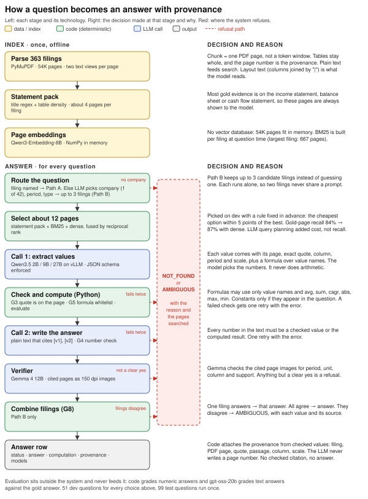

Live demo: finqa-demo.vercel.app (step-by-step replay of the system on sample questions, and all 150 answers with their cited pages). Code and full results: github.com/moriowen/finqa. The system diagram is on page 3.

I set one rule before designing anything: a wrong answer is worse than no answer. If the system cannot point to evidence that it has checked, it returns NOT_FOUND and gives the reason. Results are reported as correct, wrong and refused, and the main number is the wrong-answer rate.

## 1. System design

**Parsing.** PyMuPDF reads each of the 363 filings page by page and stores every page twice: plain text for search, and layout text that keeps table rows and columns (joined with "|") for the model to read. The page index becomes the PDF page number in the provenance. At index time, the code marks the pages whose title is a primary statement (income statement, balance sheet, cash flow statement). I call these the statement pack. When I looked at the gold evidence, most answers were on those pages.

**Retrieval.** For the filing named in the question, the model sees the statement pack, the top BM25 pages and the top pages by embedding similarity (Qwen3-Embedding-8B), at most 12 pages. This finds a gold page for 87% of the dev questions. I compared four retrieval options on the dev questions, with a selection rule written down before the results.

**Generation.** The answer takes two LLM calls with code checks around them.

1. The model returns JSON (the schema is enforced by vLLM). It lists each value it needs, with the page, the exact quote, the column, the period and the unit, plus a formula over the value names.
2. Code checks that each quote is on its page and contains the value, and that the formula uses only value names and a few functions. Python then does the arithmetic.
3. A second call writes the answer text and cites values as [v1]. Code checks that every number in the text is a checked value or the computed result.
4. A verifier model from another family (Gemma 4 12B) looks at images of the cited pages and confirms the period, unit, column and support.
5. Code attaches the provenance (filing, page, quote, passage) from the checked values. The LLM never writes a page number.

A failed check gets one retry with the error message, then NOT_FOUND. When the question names no filing, a router picks up to three candidate filings, each runs the same pipeline, and disagreement returns AMBIGUOUS.

Models: Qwen3.5 at 2B, 9B and 27B (27B in FP8), served with vLLM on Georgia Tech's ICE cluster. I tuned on 51 dev questions and ran the other 99 once at the end. Text answers were graded by gpt-oss-20b, which agreed with the FinanceBench paper's 2,400 human labels 76% of the time. Numeric answers were graded by code.

## 2. Answers with provenance

The official configuration is Qwen3.5-9B with the full pipeline, chosen on the dev questions because it had the fewest wrong answers. Every answer and refusal, with page, quote, passage and an image of the cited page, is in the demo and in results/answers.md. Totals over the 150 questions:

| Setup | Correct | Wrong | Refused | Wrong-answer rate |
|---|---|---|---|---|
| 9B, same pages, one prompt, no checks | 91 | 59 | 0 | 39% |
| **9B, full pipeline (official)** | **71** | **17** | **62** | **11%** |
| 27B (FP8), full pipeline | 76 | 24 | 50 | 16% |
| 27B (FP8), full pipeline, no filing named | 72 | 20 | 58 | 13% |
| GPT-4 Turbo, paper, single store (human labels) | 75 | 17 | 58 | 11% |
| GPT-4 Turbo, paper, shared store, no filing named | 29 | 20 | 101 | 13% |

Every 9B answer cites the right filing, and 84% cite a page that the dataset marks as evidence. Three rows from the answer file:

- *Which of JPM's segments had the highest net income in 2022 Q2?* Corporate & Investment Bank, $3,725 million. Computed as max over four segment values. Evidence: JPMORGAN_2022Q2_10Q, page 27, "Net income | $3,725", plus pages 22 and 33 for the other segments.
- *Does American Water Works have positive working capital in FY2022?* No: $1,250 million current assets minus $2,811 million current liabilities is -$1,561 million. Evidence: AMERICANWATERWORKS_2022_10K, page 81 "Total current assets | 1,250" and page 82 "Total current liabilities | 2,811".
- *Is Verizon's liquidity healthy based on its quick ratio for FY2022?* NOT_FOUND. Reason: the extractor found the inputs on page 56 but could not tell which items the quick ratio should include.

## 3. What worked, what didn't, and what I'd change

**What worked.** The checks did more than model size. For 9B they cut wrong answers from 59 to 17, and a local 9B model ended up level with GPT-4 Turbo in the paper's comparable setup (the graders differ, so this is approximate). On 290 questions paired with a filing that holds no answer, the 9B pipeline answered once, and without the checks it answered 20 times. Without a named filing, 27B got 72 right against GPT-4 Turbo's 29. Letting code do the arithmetic and attach the citations meant no answer could cite text that is not on its page.

**What didn't.** A bigger model did not lower the wrong-answer rate. 27B is better without checks (33% wrong against 39%) but with them it answers more and is wrong more often (16% against 11%). The verifier is the weak part: it caught 8 of 26 wrong 9B answers and 4 of 26 wrong 27B answers. Most remaining errors are definition choices, such as working capital from total instead of operating items, or a different quick ratio. The numbers are real and correctly cited, so no check catches them. A glossary of definitions in the prompt made things worse. For 9B, retrieval was not the limit: with the gold pages it still got 71 right. 2B passes the checks on only 9% of questions.

**With more time.** First, show the definition the system used, or ask the user, when a metric has more than one common definition. Second, have the verifier check the formula against the question, not only the values against the page. Third, recover some of the 35 questions that fail a code check twice, with a further retry or a larger model only on retry. The compute limit also shaped the runs: 80 GB GPUs were not available, so 27B ran in FP8, the verifier was a 12B model and the judge a 20B model, all with one seed. With more compute I would rerun at full precision with a larger verifier and judge, and several seeds.

```{=html}
<div class="figure-page">
```

```{=html}
</div>
```
